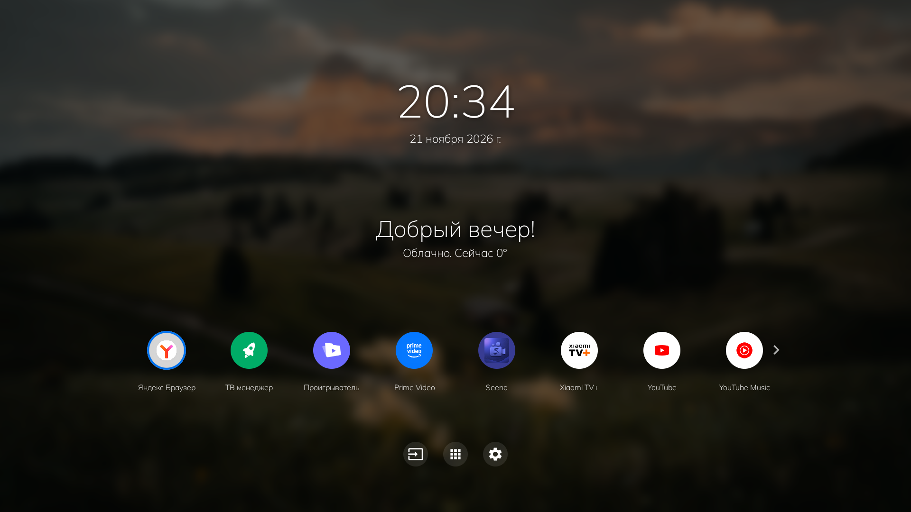

# Taylor Launcher

Taylor Launcher turns an Android TV into a calm, personal home screen built around
the remote in your hand. One screen shows everything you need at a glance — the time,
the date, a greeting, the weather and the apps you actually use — without rows of
recommendations, banners or clutter.

It is designed for the living room: large readable text, a single horizontal app row,
quick actions at the bottom, and predictable D-pad navigation. Sit back, pick an app,
and go.

## A home screen, not a storefront

The main screen stays out of the way. The clock and greeting adapt to the time of day,
the weather reflects the device's region, and the background quietly rotates through
photographs. Nothing demands your attention, and nothing competes with the app you
want to open.

## Apps you choose

Only the apps you pick appear on the home screen, in the order you set. The row moves
smoothly with the remote, wraps around from end to end and keeps the focused app in
view. Tile size, spacing, corners, label font and the number of visible apps can be
tuned to match the TV and the room.

## All apps when you need them

A single button opens the full grid of installed apps over the same wallpaper. It is
made for a remote: focus never leaves the grid, BACK takes you home, and the labels
follow the same font and size as the rest of the launcher.

## Wallpaper that sets the mood

The background rotates through carefully chosen photography and remembers what has
already been shown, so images do not repeat. Blur and brightness can be softened for
readability, and a bundled photo keeps the screen looking right even without a network.

## Sleep when the room is quiet

After a chosen idle time the screen gently dims and blurs instead of going harshly
black. Blur, brightness, fade length and the sleeping background can all be adjusted.
Those who prefer it can hand the screen over to the TV's own screensaver instead.

## TV inputs within reach

Connected HDMI and tuner inputs are listed with their status and open with one click.
If the TV firmware does not accept input switching, a built-in viewer takes over so
you can still see what is on the other source.

## Made for the remote

Every action is reachable with the D-pad. Focus is always visible, movement is
predictable, and BACK always returns where you expect. There are no hidden gestures
and no touch required.

## Settings that make sense

A side panel keeps the essentials together: clock format, wallpaper blur and
brightness, font and text size, which apps appear on the home screen and in what
order, tile geometry, animations, sleep behaviour, and shortcuts to the TV's own
display settings.

## Supported devices

Taylor Launcher runs on Android TV, Google TV, Fire TV and AOSP TV boxes with Android
5.0 or newer, in landscape, with a D-pad remote. Samsung Tizen and LG webOS televisions
are not supported.

## Your data stays on your TV

There is no account and no sign-in. Settings and preferences live on the device. The
launcher uses the network only for the weather and for downloading new wallpaper
photographs.
